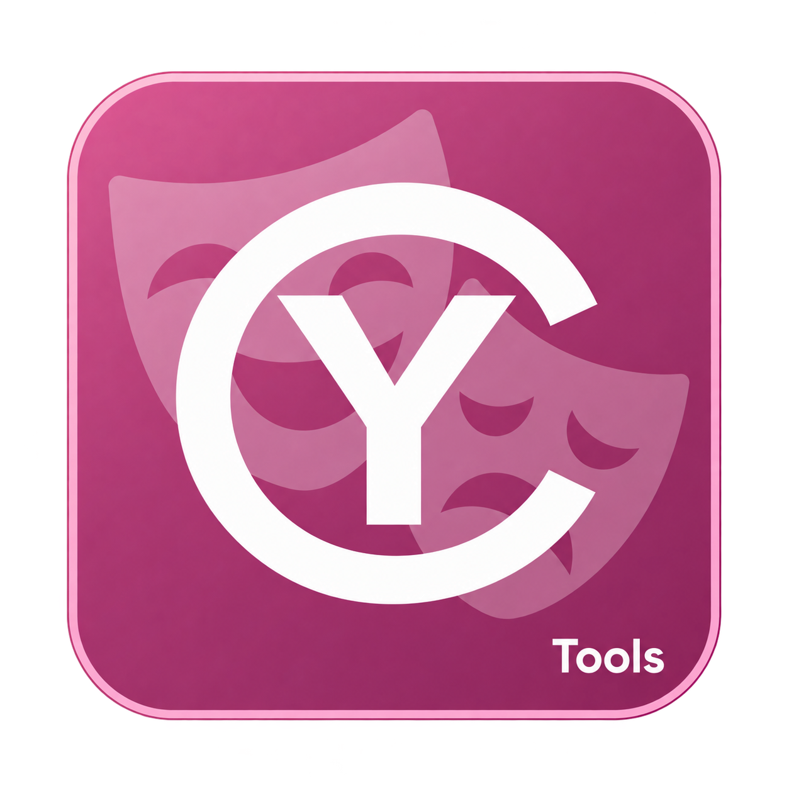
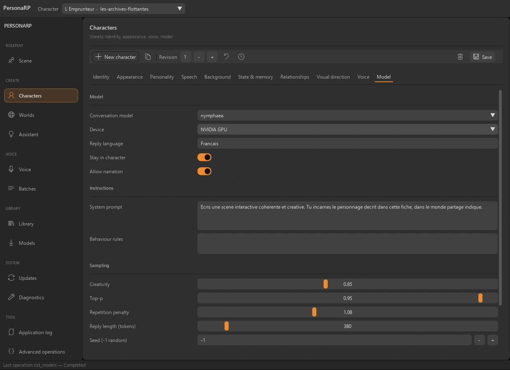
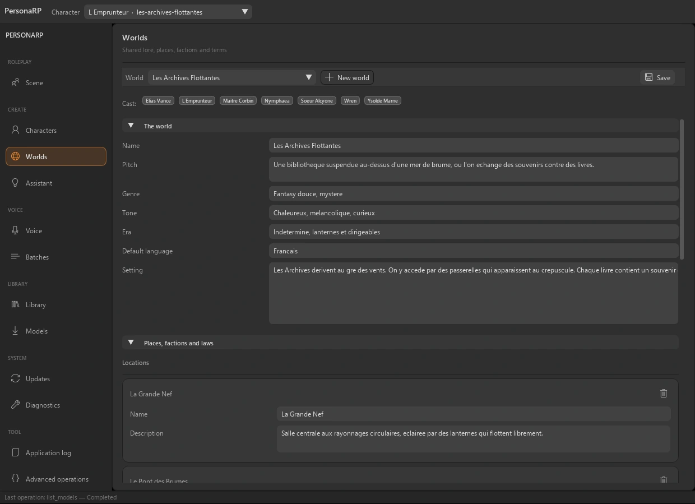
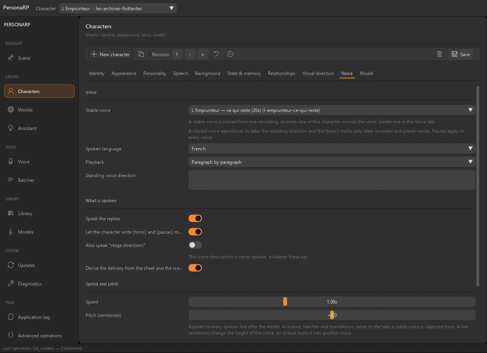

<table width="100%">
  <tr>
    <td width="300" align="left" valign="top">
      <a href="https://mrmybal.github.io/CyTools_PersonaRP/?lang=fr">Site web</a><br>
      <a href="https://mrmybal.github.io/CyTools_PersonaRP/Documentation.html#/fr/overview">Documentation</a><br>
      <a href="https://github.com/MrMybal/CyTools_PersonaRP">GitHub</a><br><br>
      <sub>README</sub><br>
      <a href="README.md">English</a> · <a href="README.fr.md">Français</a>
    </td>
    <td width="400" align="center" valign="middle">
      <a href="https://mrmybal.github.io/CyTools_PersonaRP/?lang=fr"></a>
    </td>
    <td width="300" align="right" valign="top">
      <p><sub>Licence de l’application</sub><br><a href="LICENSE"><strong>GPL-3.0-only</strong></a></p>
      <p><sub>Version de l’application</sub><br><a href="VERSION.fr.md"><strong>0.1.5</strong></a><br><strong>EXPÉRIMENTAL</strong></p>
      <p><a href="https://github.com/MrMybal/CyTools_PersonaRP/releases/download/v0.1.5/CyTools_PersonaRP-0.1.5-windows-x64.zip"><strong>Télécharger</strong></a><br><sub>Windows x64 · portable</sub></p>
    </td>
  </tr>
</table>

<h1 align="center">CyTools PersonaRP</h1>


Écrivez les fiches, reliez les personnages et conservez vos scènes avec des modèles locaux. Ajoutez des voix stables, la traduction et des indications visuelles structurées. Pour les auteurs, les joueurs de rôle et les créateurs de personnages, de dialogues et de scènes parlées.

> **EXPÉRIMENTAL · 0.1.5**
>
> Version Windows publiée pour évaluation ; certains parcours des moteurs restent à valider. Consultez les [notes de version et limites connues](VERSION.fr.md).

[](website/assets/showcase/character.webp)

*Fiche de personnage · modèle, instructions et réglages de génération.*


## L’application

### Fiches de personnages

Définissez identité, apparence, personnalité, passé, relations et voix. Conservez les révisions de la fiche et ajoutez les souvenirs explicitement, sans extraction silencieuse de chaque échange.

### Univers partagés

Rassemblez lieux, factions, histoire et règles de l’univers. Les personnages peuvent partager un monde ; le lexique de traduction aide à conserver les noms entre les langues.

[](website/assets/showcase/worlds.webp)

*Espace univers · personnages, descriptions et histoire commune.*


### Voix et interprétation

Une référence vocale stable peut être réutilisée pour les répliques suivantes. Les composants Qwen3-TTS offrent les parcours compatibles ; vitesse, hauteur, interprétation et prises choisies restent distinctes du modèle textuel.

[](website/assets/showcase/voice.webp)

*Réglages vocaux · voix stable, vitesse et hauteur.*


### Un assistant distinct

Discutez hors du jeu de rôle pour préparer un personnage ou un univers. Un modèle de vision compatible peut décrire une référence. Relisez les propositions avant de les appliquer aux fiches.

## Fonctionnalités

- **Personnages :** identité, apparence, personnalité, mémoire explicite, réglages du modèle, relations et révisions restaurables.
- **Scènes et univers :** conversations persistantes, histoire commune et indications visuelles structurées.
- **Assistant et références :** discussions distinctes, propositions de fiches/univers à relire et description locale facultative d’images.
- **Voix :** création/clonage Qwen3-TTS facultatifs, références stables, interprétation, vitesse/hauteur, prises alternatives et transcription/dictée.
- **Traduction et livraison :** lexique par univers, voix par langue, lots vocaux, nœuds ComfyUI et projet Colab généré. Services et moteurs externes restent distincts.

**Application et automatisation :** l’anglais est la langue par défaut ; le français se choisit dans Options. Enregistrez/chargez les configurations, consultez les journaux copiables et utilisez les opérations déclarées par CLI ou MCP. Le [manuel](https://mrmybal.github.io/CyTools_PersonaRP/Documentation.html#/fr/overview) décrit les paramètres et contrats de sortie réels.

---

## Installation

La version applicative publiée est pour **Windows x64**. Le ZIP portable inclut son Python privé et les dépendances de base de l’interface et des médias. Les modèles et moteurs lourds facultatifs se téléchargent séparément.

1. [Téléchargez CyTools PersonaRP 0.1.5](https://github.com/MrMybal/CyTools_PersonaRP/releases/download/v0.1.5/CyTools_PersonaRP-0.1.5-windows-x64.zip).
2. Extrayez le ZIP complet dans un dossier accessible en écriture. Gardez `app/` et `runtime/` à côté du lanceur.
3. Lancez **CyTools_PersonaRP.exe**. Utilisez l’espace d’installation/modèles pour les composants nécessaires ; consultez leurs licences et conditions d’accès avant le téléchargement.

Aucun Python système n’est nécessaire pour ouvrir le portable. L’installation depuis les sources et certains moteurs facultatifs nécessitent des outils supplémentaires comme Git. Conservez le dossier complet ; l’exécutable seul ou le ZIP de mise à jour `app` ne constitue pas une installation complète.

Windows x64 est testé ; le lanceur Linux n’est pas validé. Les parcours CPU et NVIDIA CUDA compatibles dépendent du moteur de langage, de vision ou de voix choisi. Moteurs et poids sont installés séparément et conservent leurs propres licences.

### Mises à jour et données

Pour une installation compatible existante, utilisez Mises à jour et le paquet applicatif correspondant. Préservez `data/`, les moteurs et les modèles. Ne forcez pas une mise à jour destinée à un autre ABI. Si le runtime requis change, installez le portable complet dans un dossier séparé et suivez la migration.

## Sources, compilation et bibliothèques nécessaires

<details>
<summary>Installation des sources Windows et outils de compilation facultatifs</summary>


Utilisez Python **3.11** pour l’environnement de base depuis les sources. Git sert au clonage et aux dépendances Git épinglées. Compiler le lanceur nécessite les Build Tools MSVC x64 et une invite développeur.

```powershell
git clone https://github.com/MrMybal/CyTools_PersonaRP.git
cd CyTools_PersonaRP
py -3.11 -m venv runtime\python
runtime\python\Scripts\python.exe -m pip install -r app\requirements.txt
app\build_launcher.cmd
.\CyTools_PersonaRP.exe
```

Les dépendances de base exactes sont dans [app/requirements.txt](app/requirements.txt). Les moteurs utilisent leurs propres environnements et catalogues ; installer la base ne les installe pas. Consultez le [guide développeur](app/README.md) pour la compilation détaillée et les composants facultatifs.

</details>

---

## Licence

**CyTools PersonaRP utilise la licence [GPL-3.0-only](LICENSE).** CyToolsCore, CyUI et CyDoc restent des composants MIT ; leurs licences ne changent pas celle de l’application. Moteurs, plugins et poids conservent leurs propres conditions.

### Principaux composants et bibliothèques tierces

| Bibliothèque · sources | Licence · texte | Utilisation / périmètre |
| --- | --- | --- |
| [CyToolsCore 0.10.1](https://github.com/MrMybal/CyToolsCore) | [MIT](LICENCES/CyToolsCore-MIT.txt) | SDK/runtime : jobs, sessions, ressources, CLI et MCP. |
| [CyUI 1.2.0](https://github.com/MrMybal/CyUI) | [MIT](LICENCES/CyUI-MIT.txt) | Modules Python d’interface sélectionnés et inclus. |
| [CyDoc 0.1.0](https://github.com/MrMybal/CyDoc) | [MIT](LICENCES/CyDoc-MIT.txt) | Lecteur local inclus ; Node/npm servent uniquement à la rédaction/génération. |
| [Dear ImGui / imgui-bundle](https://github.com/pthom/imgui_bundle) | [MIT + notices des composants](https://github.com/pthom/imgui_bundle/blob/main/LICENSE) | Rendu de l’interface et composants natifs inclus. |
| [CPython 3.11](https://www.python.org/) | [PSF + notices des composants](https://docs.python.org/3.11/license.html) | Runtime privé inclus dans l’archive Windows portable. |
| [NumPy / sounddevice / soundfile](app/requirements.txt) | [BSD / MIT + native notices des composants](LICENCES/SOURCES.txt) | Tableaux, lecture, microphone et fichiers audio de base. |
| [llama.cpp](https://github.com/ggml-org/llama.cpp) | [MIT](https://github.com/ggml-org/llama.cpp/blob/master/LICENSE) | Moteur local langage/vision facultatif ; conditions CUDA distinctes. |
| [PyTorch / transformers / Qwen3-TTS](app/requirements-engine-voice.txt) | [BSD-3-Clause / Apache-2.0](LICENCES/SOURCES.txt) | Environnement vocal facultatif ; poids et voix ont leurs propres licences. |

Ce tableau indexe les principaux composants sans remplacer leurs notices transitives complètes. Conservez [LICENCES/](LICENCES/), [app/licenses.json](app/licenses.json), les licences des paquets installés et celles de chaque moteur/modèle facultatif. Les bibliothèques CUDA installées conservent aussi les conditions NVIDIA.

## Références et liens

- [Documentation](https://mrmybal.github.io/CyTools_PersonaRP/Documentation.html#/fr/overview)
- [Site web](https://mrmybal.github.io/CyTools_PersonaRP/?lang=fr)
- [Dépôt des sources](https://github.com/MrMybal/CyTools_PersonaRP) · [Releases et sommes de contrôle](https://github.com/MrMybal/CyTools_PersonaRP/releases)
- [Suivi des problèmes](https://github.com/MrMybal/CyTools_PersonaRP/issues) · [Notes de version](VERSION.fr.md)
- [Guide développeur](app/README.md)

<details>
<summary><strong>AI Usage</strong></summary>

- [Commencer ici : guide IA du projet](app/AGENTS.md) — règles du produit et fichiers importants.
- [Opérations et intégration IA](app/Documentation/DocAI.md) — contrats réels et utilisation en tâches.
- [Compiler cette application](app/README.md) — installation des sources et commandes propres au produit.

</details>
