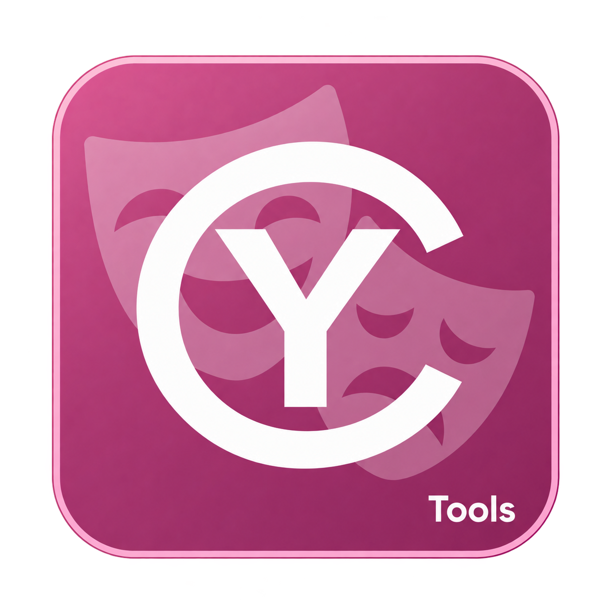
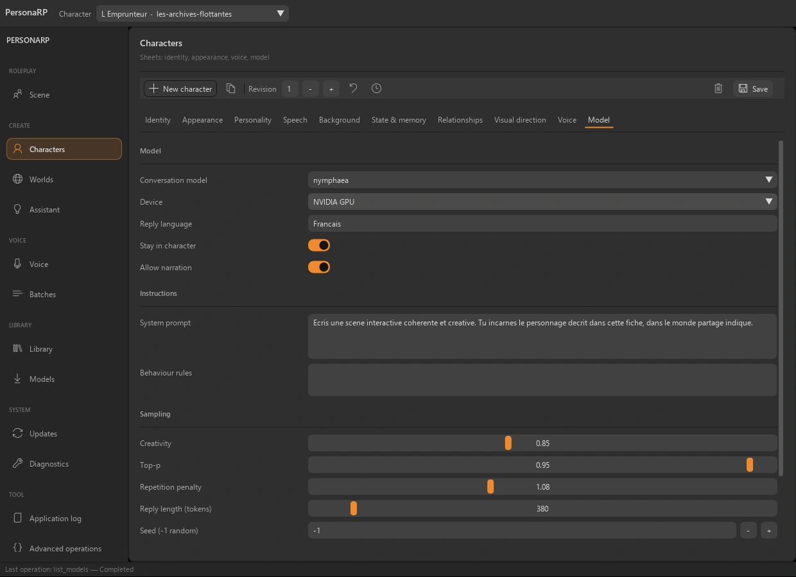
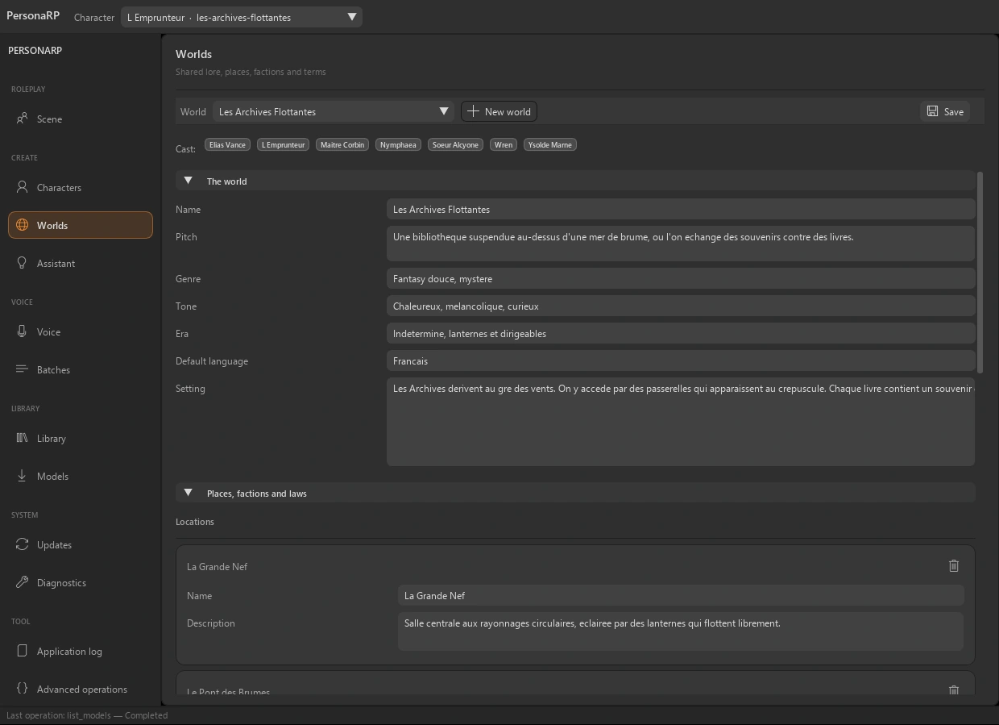
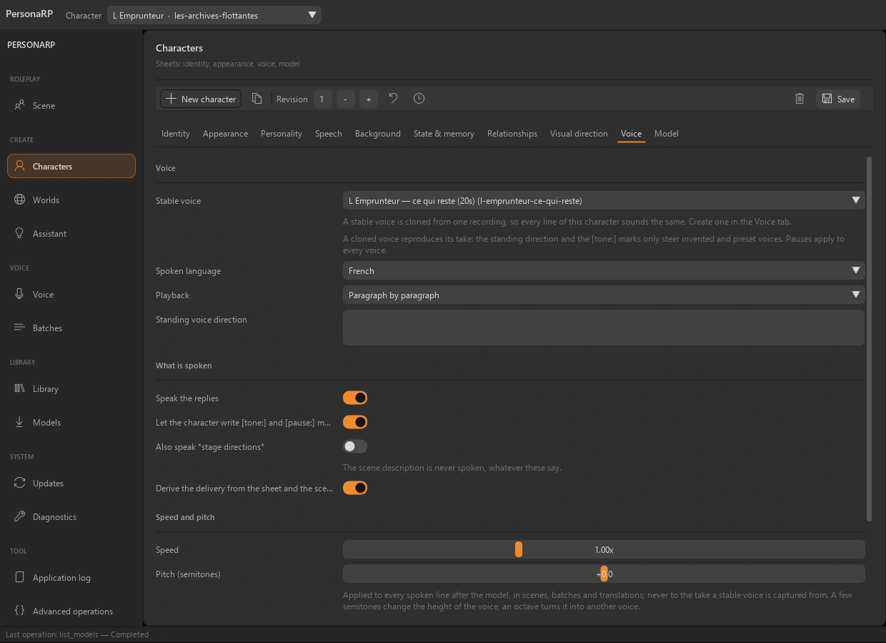

<table width="100%">
  <tr>
    <td width="300" align="left" valign="top">
      <a href="https://mrmybal.github.io/CyTools_PersonaRP/">Website</a><br>
      <a href="https://mrmybal.github.io/CyTools_PersonaRP/Documentation.html#/en/overview">Documentation</a><br>
      <a href="https://github.com/MrMybal/CyTools_PersonaRP">GitHub</a><br><br>
      <sub>README</sub><br>
      <a href="README.md">English</a> · <a href="README.fr.md">Français</a>
    </td>
    <td width="400" align="center" valign="middle">
      <a href="https://mrmybal.github.io/CyTools_PersonaRP/"></a>
    </td>
    <td width="300" align="right" valign="top">
      <p><sub>Application license</sub><br><a href="LICENSE"><strong>GPL-3.0-only</strong></a></p>
      <p><sub>Application version</sub><br><a href="VERSION.md"><strong>0.1.5</strong></a><br><strong>EXPERIMENTAL</strong></p>
      <p><a href="https://github.com/MrMybal/CyTools_PersonaRP/releases/download/v0.1.5/CyTools_PersonaRP-0.1.5-windows-x64.zip"><strong>Download</strong></a><br><sub>Windows x64 · portable</sub></p>
    </td>
  </tr>
</table>

<h1 align="center">CyTools PersonaRP</h1>


Write character sheets, connect relationships and keep roleplay scenes with local models. Add stable voices, translation and structured visual directions. For writers, roleplayers and creators preparing characters, dialogue and spoken scenes.

> **EXPERIMENTAL · 0.1.5**
>
> Published Windows build for evaluation; some engine paths remain unvalidated. Read the [version notes and known limitations](VERSION.md).

[](website/assets/showcase/character.webp)

*Character sheet · conversation model, instructions and sampling settings.*


## The application

### Character sheets

Define identity, appearance, personality, history, relationships and voice. Keep revisions of the sheet and add memories explicitly rather than extracting them silently from every conversation.

### Shared worlds

Keep places, factions, lore and world rules together. Characters can share a world, while translation terms help keep names consistent between languages.

[](website/assets/showcase/worlds.webp)

*World workspace · cast, descriptions and shared lore.*


### Voice & performance

A stable reference voice can be reused for later lines. Qwen3-TTS components provide compatible voice generation paths; speed, pitch, delivery and selected takes are managed separately from the text model.

[](website/assets/showcase/voice.webp)

*Character voice settings · stable voice, speed and pitch.*


### A separate assistant

Use a conversation outside roleplay to draft a character or a world. A compatible vision model can describe a reference picture. Review proposals before applying them to stored sheets.

## Features

- **Characters:** identity, appearance, personality, explicit memory, model settings, relationships and restorable revisions.
- **Scenes and worlds:** persistent roleplay conversations, shared lore and structured visual scene directions.
- **Assistant and references:** separate assistant threads, reviewable sheet/world proposals and optional local picture description.
- **Speech:** optional Qwen3-TTS voice design/cloning, stable reference voices, delivery, speed/pitch, alternate takes and transcription/dictation.
- **Translation and delivery:** per-world terminology, language-specific voices, voice batches, ComfyUI nodes and a generated Colab project. External services and engines remain separate.

**Desktop and automation:** English is the default interface language; French is selectable in Options. Save/load generation configurations, follow copyable application logs and use the declared operations through the CLI or MCP. The [manual](https://mrmybal.github.io/CyTools_PersonaRP/Documentation.html#/en/overview) describes the real parameters and output contracts.

---

## Installation

The published application build is **Windows x64**. The portable ZIP includes its private Python runtime and base UI/media dependencies. Models and optional heavy engines are separate downloads.

1. [Download CyTools PersonaRP 0.1.5](https://github.com/MrMybal/CyTools_PersonaRP/releases/download/v0.1.5/CyTools_PersonaRP-0.1.5-windows-x64.zip).
2. Extract the complete ZIP into a writable folder. Keep `app/` and `runtime/` beside the launcher.
3. Open **CyTools_PersonaRP.exe**. Use the installation/model workspace for the components you need; review each component licence and any provider access conditions before download.

No machine Python is needed just to open the portable application. Source setup and some optional engine installers require additional tools such as Git. Keep the full release folder; the standalone `.exe` or an `app` update ZIP alone is not a complete installation.

Windows x64 is tested; the Linux launcher is unvalidated. CPU and compatible NVIDIA CUDA paths depend on the selected language, vision or speech engine. Engines and model weights are installed separately and retain their own licences.

### Updates and data

For an existing compatible installation, use its Updates page and the matching application update package. Keep `data/`, installed engines and models. An update for another runtime ABI must not be forced. If the required runtime changes, use the complete portable release in a separate folder and follow the migration instructions.

## Source, build and required libraries

<details>
<summary>Windows source setup and optional build tools</summary>


Use Python **3.11** for the base source environment. Git is needed for cloning and pinned Git requirements. Building the launcher needs the MSVC x64 Build Tools; use a developer command prompt.

```powershell
git clone https://github.com/MrMybal/CyTools_PersonaRP.git
cd CyTools_PersonaRP
py -3.11 -m venv runtime\python
runtime\python\Scripts\python.exe -m pip install -r app\requirements.txt
app\build_launcher.cmd
.\CyTools_PersonaRP.exe
```

The exact base requirements are in [app/requirements.txt](app/requirements.txt). Engines use their own environments and model catalogues; installing the base environment does not install them. Follow the [developer setup](app/README.md) for the detailed build and optional components.

</details>

---

## License

**CyTools PersonaRP is licensed under [GPL-3.0-only](LICENSE).** CyToolsCore, CyUI and CyDoc remain MIT components; their licences do not change the application licence. Optional engines, plugins and model weights retain their own terms.

### Main components and third-party libraries

| Library · source | License · terms | Use / scope |
| --- | --- | --- |
| [CyToolsCore 0.10.1](https://github.com/MrMybal/CyToolsCore) | [MIT](LICENCES/CyToolsCore-MIT.txt) | SDK/runtime: jobs, sessions, resources, CLI and MCP. |
| [CyUI 1.2.0](https://github.com/MrMybal/CyUI) | [MIT](LICENCES/CyUI-MIT.txt) | Selected bundled Python UI modules. |
| [CyDoc 0.1.0](https://github.com/MrMybal/CyDoc) | [MIT](LICENCES/CyDoc-MIT.txt) | Bundled offline reader; Node/npm are authoring/build tools only. |
| [Dear ImGui / imgui-bundle](https://github.com/pthom/imgui_bundle) | [MIT + component notices](https://github.com/pthom/imgui_bundle/blob/main/LICENSE) | Desktop renderer and its bundled native components. |
| [CPython 3.11](https://www.python.org/) | [PSF + component notices](https://docs.python.org/3.11/license.html) | Private runtime included in the Windows portable archive. |
| [NumPy / sounddevice / soundfile](app/requirements.txt) | [BSD / MIT + native component notices](LICENCES/SOURCES.txt) | Base arrays, playback, microphone and audio files. |
| [llama.cpp](https://github.com/ggml-org/llama.cpp) | [MIT](https://github.com/ggml-org/llama.cpp/blob/master/LICENSE) | Optional local language/vision engine; CUDA libraries have separate terms. |
| [PyTorch / transformers / Qwen3-TTS](app/requirements-engine-voice.txt) | [BSD-3-Clause / Apache-2.0](LICENCES/SOURCES.txt) | Optional speech environment; model weights and voices have separate licences. |

This table indexes the main components; it does not replace their complete transitive notices. Retain [LICENCES/](LICENCES/), [app/licenses.json](app/licenses.json), the licences beside installed packages and the notices in each optional engine/model. CUDA libraries, when installed, also retain NVIDIA’s terms.

## References and links

- [Documentation](https://mrmybal.github.io/CyTools_PersonaRP/Documentation.html#/en/overview)
- [Website](https://mrmybal.github.io/CyTools_PersonaRP/)
- [Source repository](https://github.com/MrMybal/CyTools_PersonaRP) · [Releases and checksums](https://github.com/MrMybal/CyTools_PersonaRP/releases)
- [Issue tracker](https://github.com/MrMybal/CyTools_PersonaRP/issues) · [Version notes](VERSION.md)
- [Developer setup](app/README.md)

<details>
<summary><strong>AI Usage</strong></summary>

- [Start here: project agent guide](app/AGENTS.md) — product rules and important files.
- [Operations and AI integration](app/Documentation/DocAI.md) — actual tool contracts and task usage.
- [Build this application](app/README.md) — source setup and application-specific commands.

</details>
